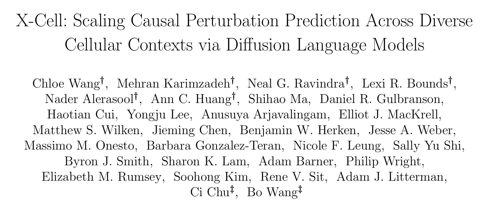

<p align="center">
  <a href="https://doi.org/10.64898/2026.03.18.712807">
    
  </a>
</p>

<div align="center">

<h1>Open-X-Cell</h1>
<h3>Train and run a clean-room X-Cell model</h3>

<p align="center">Part of the <a href="https://github.com/youlab2025/UPM"><strong>UPM</strong></a> project.</p>

<p>
<a href="https://github.com/zongtingwei/Open-X-cell"></a>
<a href="https://huggingface.co/zongting/Open-X-cell"></a>


<a href="LICENSE"></a>
</p>

<p>
<a href="#overview">Overview</a> ·
<a href="#installation">Installation</a> ·
<a href="#pretrained-model">Pretrained model</a> ·
<a href="#inference-quickstart">Inference</a> ·
<a href="#training">Training</a> ·
<a href="#python-api">Python API</a>
</p>

</div>

## Overview

Open-X-Cell is part of the [UPM (Unified Perturbation Modeling)](https://github.com/youlab2025/UPM) project, supporting the work *How Much Can AI Virtual Cells Gain from Unified Perturbational Modeling?* This repository provides the X-Cell implementation and checkpoint release; visit the UPM main repository for the overall project.

**Open-X-Cell provides training, fine-tuning, inference, and evaluation for a clean-room PyTorch implementation of X-Cell.** It predicts gene-perturbation responses from control cells using a Transformer, five fixed biological priors, and four diffusion reveal steps.

This release includes the working training implementation, a pretrained **Mini public Orion proxy**, a complete portable inference bundle, and a small HEK293T example. The implementation and checkpoint are an independent reproduction; they are not Xaira's official implementation or Pisces checkpoint.

| Capability | Included |
| :--- | :--- |
| Training | Tiny/Mini/Ultra configurations, control/target sets, losses, AMP, DDP, gradient accumulation, activation checkpointing, warmup-cosine scheduling, and exact run resume. |
| Initialization | scGPT warm-start and Open-X-Cell checkpoint fine-tuning with gene-vocabulary checks. |
| Inference | Single-gene perturbation prediction, context/batch-aware controls, multiple sampled control sets, four-step diffusion, and optional TTA through the research CLI. |
| Portable model | Safetensors weights, architecture, gene vocabulary, all five fixed priors, provenance, and SHA-256 checksums. |
| Evaluation | Built-in metrics, batch evaluation, and adapters for the separately installed `cell-eval` package. |

## Installation

Use Python 3.10 or later. Install a PyTorch build suitable for your CPU or CUDA environment, then install the package:

```bash
git clone https://github.com/zongtingwei/Open-X-cell.git
cd Open-X-cell
python -m pip install -e '.[dev,metrics]'

open-x-cell --help
open-x-cell-infer --help
```

Both the training and inference entry points are installed by the same package. A GitHub installation also works:

```bash
python -m pip install git+https://github.com/zongtingwei/Open-X-cell.git
```

The examples below use files from the repository checkout. Access to this private code repository requires an authorized GitHub account. The checkpoint is hosted separately on Hugging Face and requires an authorized HF account.

## Pretrained model

The [Hugging Face model repository](https://huggingface.co/zongting/Open-X-cell) contains the original `checkpoint.pt`, portable Safetensors weights, all five fixed priors, configuration, vocabulary, checksums, and HEK293T examples. Training and inference source code are maintained in this GitHub repository.

| Property | Released checkpoint |
| :--- | :--- |
| Model | Open-X-Cell Mini public Orion proxy |
| Parameters | 60,001,618 |
| Transformer | 12 layers, hidden width 512, 8 heads |
| Vocabulary | 19,408 gene symbols |
| Training contexts | Public Orion HCT116 and HEK293T |
| Training | 4,155 optimizer steps; approximately 6 effective epochs; dynamic target-first 4,000-gene contexts |
| Numerical format | Float32 Safetensors weights; float32 fixed prior arrays |
| Fixed priors | ESM-2 5,120; STRING 512; GenePT 3,072; DepMap 1,150; Cell Painting 259 dimensions |

The bundle retains available prior rows for the checkpoint vocabulary. Missing gene/source combinations keep the model's existing missing-prior behavior. It includes no optimizer state; use a training run's `latest.pt` for exact resume, or the released weights for a fresh fine-tune.

Authenticate with Hugging Face, then download the complete inference bundle:

```bash
hf auth login
open-x-cell-download --output checkpoints/mini-orion
```

The downloader uses the fixed HF revision specified in `open_x_cell.download.DEFAULT_REVISION`. To select another version, pass `--repo` and `--revision`. Allow **3 GB of disk headroom** for downloads and example outputs. Every bundle file's size and SHA-256 is checked before installation; existing directories are never overwritten.

The original PyTorch checkpoint is also available separately:

```bash
hf download zongting/Open-X-cell checkpoint.pt --revision v0.2.0 --local-dir checkpoints/original
```

`checkpoint.pt` preserves the original training export. It contains model weights, configuration and vocabulary, but no optimizer state; exact training resume requires your run's `latest.pt`. Use the complete portable bundle for the inference examples below, because the fixed priors are also required.

```text
checkpoints/mini-orion/
├── model.safetensors
├── config.json
├── genes.json
├── manifest.json
└── priors/
    ├── esm.npz
    ├── string.npz
    ├── genept.npz
    ├── depmap.npz
    └── cell_painting.npz
```

## Inference quickstart

### 1. Run the included HEK293T example

[examples/hek293t](examples/hek293t) contains **32 non-targeting controls** and **32 separately sampled STAT1-perturbed cells** from the shared QC-complete X-Atlas-Orion HEK293T dataset. Both files retain every measured source gene and the source `log1p(CP10K)` expression values. Gene symbols are in `.var_names`; sampling rows, seed, and checksums are in [provenance.json](examples/hek293t/provenance.json).

The following CPU smoke test uses a **256-gene inference context** to keep runtime and memory small:

```bash
open-x-cell-infer \
  --model checkpoints/mini-orion \
  --control examples/hek293t/controls.h5ad \
  --perturbation STAT1 \
  --input-space log1p-cp10k \
  --device cpu \
  --n-cells 32 \
  --max-genes 256 \
  --seed 0 \
  --output outputs/STAT1-smoke.h5ad
```

This produces **32 predicted cells × 256 genes**. `--max-genes` changes the model's context and predictions; this command is a workflow demonstration, not a full-gene benchmark. The HEK293T example is not an independent accuracy test because the checkpoint trained on Orion HEK293T.

For full overlapping-gene inference, omit `--max-genes`. Full-context attention can require substantially more memory; choose the cell-set size and hardware accordingly. Use `--device cuda --precision bfloat16` on a GPU that supports bfloat16.

### 2. Use your own controls

Supply a **control-only** `.h5ad` file and one gene symbol from `genes.json`.

- Raw counts: pass `--input-space counts`. If counts are in a layer, add `--layer counts`. Normalization uses all supplied measured columns before gene alignment or context reduction.
- Already normalized expression: pass `--input-space log1p-cp10k`.
- Gene identifiers: gene symbols in `.var_names` work directly. Ensembl IDs can be accompanied by aliases in `.var['gene_name']`, `symbol`, `gene_symbol`, `gene_id`, `gene_ids`, or `ensembl_id`.
- Controls: if `.obs['is_control']` is present, every row must be a control. If absent, supplying the file declares that all its cells are controls.
- Sampling: `--n-cells` specifies controls per set. The default single set takes the first available rows and wrap-pads a short pool. With `--n-sets` greater than one, each set samples from the pool using the supplied seed, with replacement if necessary.

| Output | Meaning |
| :--- | :--- |
| `.X` | Float32 predicted expression in the trained log-expression space. |
| `.var_names` | Overlapping checkpoint gene symbols, target first when present, then checkpoint vocabulary order. Unmatched input genes are omitted. |
| `.obs['source_control_obs_name']` | Identity of the sampled control cell for each predicted row. |
| `.obs['perturbation']` | Requested target gene. |
| `.uns['open_x_cell_prediction']` | Source hashes, bundle hash, normalization, sampling, precision, context cap, and diffusion settings. |

The output file must not already exist. An unknown target or a panel without overlapping genes is rejected. This release supports one genetic target per prediction; it does not expose UPM's drug, cytokine, or combination interface.

## Training

### End-to-end CPU smoke test

The following creates synthetic data, trains Tiny from scratch, and predicts a perturbation:

```bash
open-x-cell make-synthetic \
  --output data/synthetic.h5ad --n-cells 128 --n-genes 32

open-x-cell train \
  --adata data/synthetic.h5ad --output runs/tiny \
  --model-size tiny --normalize none --device cpu \
  --batch-size 1 --set-size 4 --max-steps 4

open-x-cell predict \
  --checkpoint runs/tiny/checkpoint.pt \
  --adata data/synthetic.h5ad --perturbation GENE_1 \
  --n-cells 4 --output outputs/tiny-GENE_1.h5ad
```

Synthetic expression is already in the training scale, so this example uses `--normalize none`.

### Training input contract

Training requires control **and** observed perturbation cells:

| AnnData field | Required content |
| :--- | :--- |
| `.X` | Raw counts with `--normalize cp10k-log1p`, or pre-normalized expression with `--normalize none`. |
| `.var_names` | Unique canonical gene symbols present in the chosen model vocabulary. |
| `.obs['perturbation']` | Target gene for perturbed cells; use `control` for controls. |
| `.obs['is_control']` | Boolean control indicator. |
| `.obs['context']`, `.obs['batch']` | Optional grouping columns; provide them to preserve experimental strata. |

Mini supports a vocabulary of up to 19,408 genes. Prepare a measured panel within that vocabulary explicitly. `--training-context-length 4000` samples a new target-first context per training set without changing the checkpoint architecture. Dense H5AD training can use `--backed --normalize none --num-workers 0` for lazy expression loading.

### Fine-tune the released Mini weights

Use a compatible gene panel and pass the released vocabulary and all five priors:

```bash
open-x-cell train \
  --adata /path/to/training.h5ad --output runs/mini-finetune \
  --model-size mini --normalize none --device cuda \
  --pretrained-checkpoint checkpoints/mini-orion/model.safetensors \
  --vocabulary checkpoints/mini-orion/genes.json \
  --esm-priors checkpoints/mini-orion/priors/esm.npz \
  --string-priors checkpoints/mini-orion/priors/string.npz \
  --genept-priors checkpoints/mini-orion/priors/genept.npz \
  --depmap-priors checkpoints/mini-orion/priors/depmap.npz \
  --cell-painting-priors checkpoints/mini-orion/priors/cell_painting.npz \
  --training-context-length 4000 \
  --batch-size 1 --set-size 64 --max-steps 1000 \
  --learning-rate 0.0001 --precision bfloat16 \
  --gradient-accumulation-steps 8 --gradient-checkpointing \
  --checkpoint-every 50
```

These are example fine-tuning settings, not a claim to reproduce Xaira's private training protocol. Fine-tuning starts a fresh optimizer and scheduler. Omit `--pretrained-checkpoint` to train from scratch, or use `--scgpt-warm-start /path/to/scgpt` for compatible scGPT gene/Transformer initialization. `--scgpt-embedding-only` restricts that transfer to embeddings. Legacy `.pt` and scGPT checkpoints must come from a trusted source because those training loaders use pickle.

For DDP, replace `open-x-cell train` with `torchrun --standalone --nproc-per-node=2 -m open_x_cell.cli train` and keep the training arguments. Choose batch size, accumulation, precision, and context length for the available hardware.

### Checkpoints and resume

A training run writes `checkpoint.pt` (model weights), `latest.pt` (model plus optimizer/scheduler state), `history.json`, and `run_manifest.json`. Resume an interrupted run with the **same data, sources, prior files, settings, and original total training horizon**. Remove `--pretrained-checkpoint`, `--scgpt-init`, `--scgpt-warm-start`, and `--scgpt-embedding-only` from the original command, then add:

```bash
--resume runs/mini-finetune/latest.pt --output runs/mini-finetune
```

The trainer validates the original manifest and inputs; changing the learning-rate schedule or source code is not exact resume. Use a new fine-tuning run for a new training budget. Two-phase curriculum training is available through `--curriculum`; its CLI documents the resume/distributed restrictions.

## Python API

```python
from open_x_cell import OpenXCell

model = OpenXCell.from_pretrained("checkpoints/mini-orion", device="cpu")
print(len(model.genes))

prediction = model.predict(
    "examples/hek293t/controls.h5ad",
    perturbation="STAT1",
    output="outputs/STAT1-python.h5ad",
    input_space="log1p-cp10k",
    n_cells=32,
    max_genes=256,
    seed=0,
)
print(prediction.shape)
```

`from_pretrained` validates a local bundle; `predict` loads its weights and priors for each call. The existing `open_x_cell.training.train_model` and `open_x_cell.inference.predict_adata` APIs remain available for training and advanced inference.

## Evaluation and research interfaces

```bash
open-x-cell evaluate --help
open-x-cell evaluate-batch --help
open-x-cell predict-benchmark --help
open-x-cell predict --help
```

`predict-benchmark` supports fixed controls, sharding, and validated resume of prediction files. The research `predict` command exposes context/batch selection, TTA, and the explicitly recorded diffusion return-mode choice. When using a portable checkpoint through that command, pass `model.safetensors` and the five prior files explicitly.

The optional [assemble_cell_eval_inputs.py](scripts/assemble_cell_eval_inputs.py) and [run_cell_eval.py](scripts/run_cell_eval.py) adapters prepare and score with an independently installed `cell-eval`. The basic package and example inference do not require it.

## Export your own model

Use the exact five prior tables associated with your trusted checkpoint:

```bash
open-x-cell-export \
  --checkpoint runs/mini-finetune/checkpoint.pt \
  --esm-priors /path/to/esm.npz \
  --string-priors /path/to/string.npz \
  --genept-priors /path/to/genept.npz \
  --depmap-priors /path/to/depmap.npz \
  --cell-painting-priors /path/to/cell_painting.npz \
  --output checkpoints/my-model --trust-legacy-pickle
```

The exporter removes optimizer state, preserves float32 weights and available prior values, and writes a self-contained bundle. Normal portable inference loads Safetensors and NumPy arrays without pickle.

## Scope and provenance

The released model uses public Orion HCT116 and HEK293T data, with a declared clean-room training schedule and feature mapping. It does not include the paper's additional private Pisces screens, original private vocabulary/remap artifacts, or unpublished QC choices. Detailed training settings, source hashes, prior coverage, and methodological limitations travel with the model in `manifest.json`.

Mini is the released trained model. Tiny is intended for smoke tests. Ultra configuration and curriculum code are available, but an Ultra checkpoint and the paper's multi-billion-parameter FSDP2 stack are not included. Historical notes under `docs/` describe earlier experiments; this README and the release manifest define the current release.

The code is [MIT licensed](LICENSE). The third-party data and fixed-prior assets retain their upstream terms and attribution: [X-Atlas-Orion](https://huggingface.co/datasets/Xaira-Therapeutics/X-Atlas-Orion), [ESM](https://github.com/facebookresearch/esm), [STRING](https://string-db.org/), [GenePT](https://github.com/yiqunchen/GenePT), [DepMap](https://depmap.org/portal/), and [JUMP Cell Painting](https://github.com/jump-cellpainting/).

Paper screenshot: first-page title and author crop from [Wang et al. (2026)](https://doi.org/10.64898/2026.03.18.712807), under [CC BY-NC 4.0](https://creativecommons.org/licenses/by-nc/4.0/).

## Repository guide

| Path | Purpose |
| :--- | :--- |
| [src/open_x_cell/training.py](src/open_x_cell/training.py) | Training, fine-tuning, resume, AMP, and DDP. |
| [src/open_x_cell/model.py](src/open_x_cell/model.py) | Transformer and prior cross-attention architecture. |
| [src/open_x_cell/data.py](src/open_x_cell/data.py), [losses.py](src/open_x_cell/losses.py) | Normalization, training-set construction, and objectives. |
| [src/open_x_cell/inference.py](src/open_x_cell/inference.py) | Diffusion inference, control selection, and benchmark sharding. |
| [src/open_x_cell/api.py](src/open_x_cell/api.py) | Portable control-only API and inference CLI. |
| [src/open_x_cell/bundle.py](src/open_x_cell/bundle.py), [download.py](src/open_x_cell/download.py) | Export, checksums, and model download. |
| [examples/hek293t](examples/hek293t) | Real control/observed cells and sampling provenance. |
| [examples/prepare_hek293t.py](examples/prepare_hek293t.py) | Recreate the example from its QC-complete source. |
| [tests/open_x_cell](tests/open_x_cell) | Training, inference, export, integrity, and numerical-parity tests. |

Run the tests with `python -m pytest -q`. Report reproducible issues through [GitHub Issues](https://github.com/zongtingwei/Open-X-cell/issues), including the command, package versions, release tag, and error message.

## Citation

If you use this code, please cite our paper.

```bibtex
@misc{upm2026,
  title={How Much Can AI Virtual Cells Gain from Unified Perturbational Modeling?},
  year={2026},
  note={Manuscript in preparation},
  url={https://github.com/youlab2025/UPM}
}
```

For the original X-Cell method, please cite:

```bibtex
@article{wang2026x,
  title={X-cell: Scaling causal perturbation prediction across diverse cellular contexts via diffusion language models},
  author={Wang, Chloe and Karimzadeh, Mehran and Ravindra, Neal G and Bounds, Lexi R and Alerasool, Nader and Huang, Ann C and Ma, Shihao and Gulbranson, Daniel R and Cui, Haotian and Lee, Yongju and others},
  journal={bioRxiv},
  pages={2026--03},
  year={2026},
  publisher={Cold Spring Harbor Laboratory}
}
```
